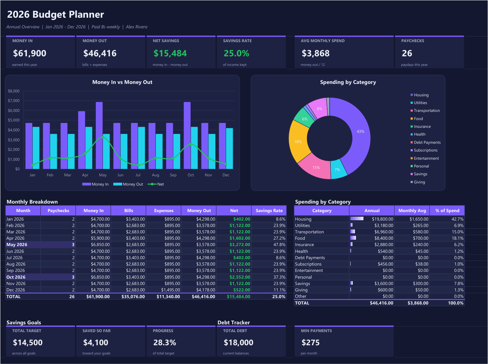
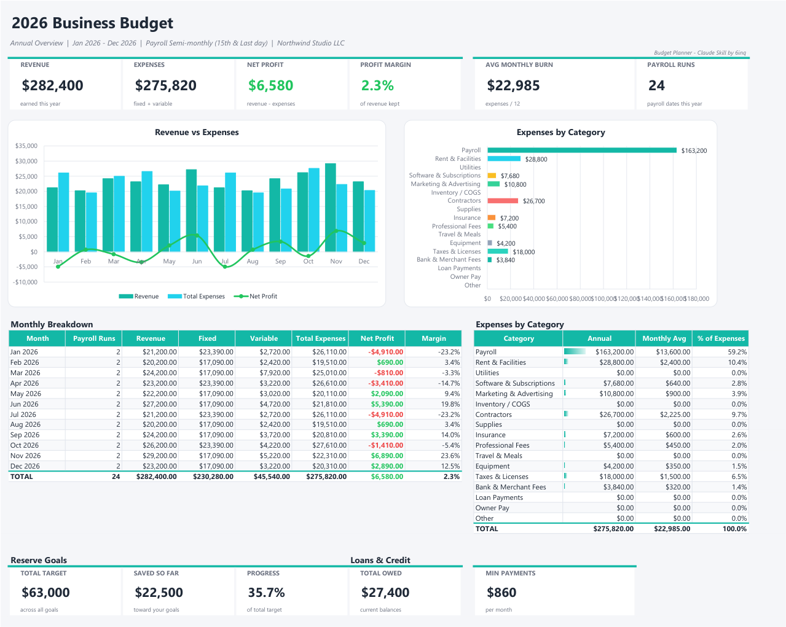
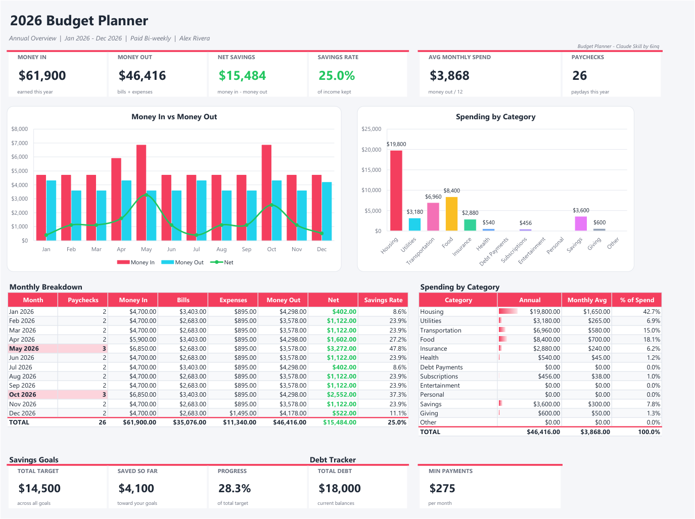
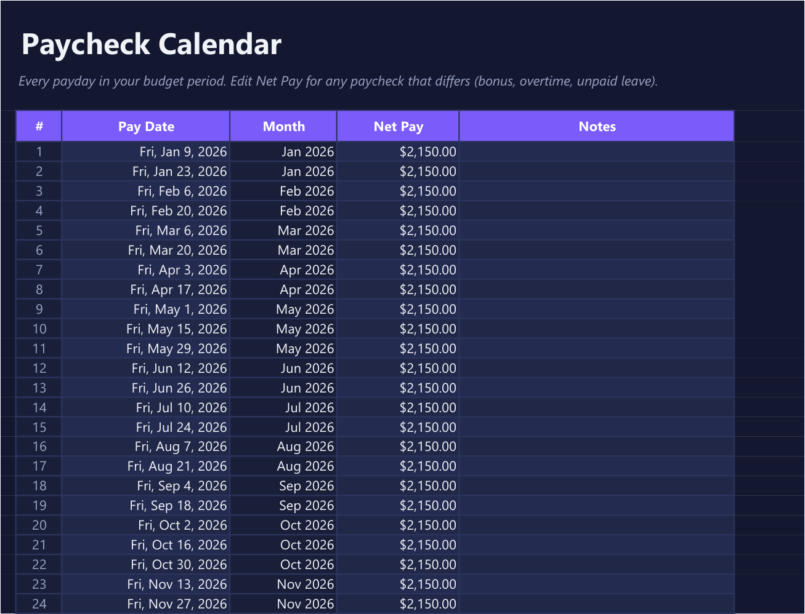
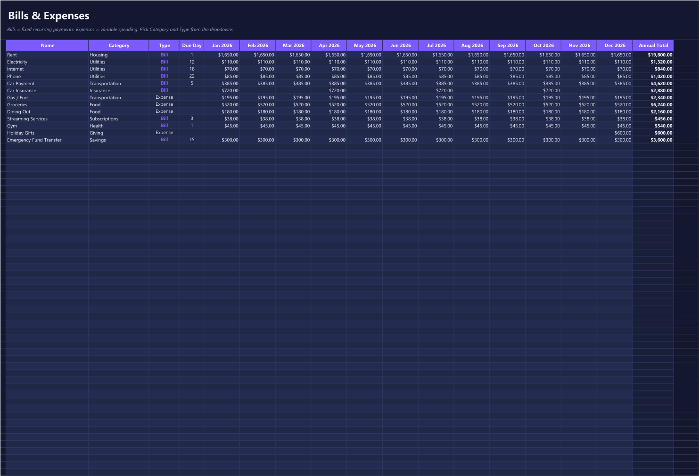

# Budget Planner: a Claude Skill

Turn a short conversation with Claude into a professional Excel budget. Say **"Start Budgeting"**, answer a few multiple-choice questions, and Claude builds a polished, fully formula-driven `.xlsx` workbook with an annual dashboard, charts, and a month-by-month breakdown, for **personal** or **business** finances, in **light** or **dark** mode.



| Business, light mode | Personal, light mode |
|---|---|
|  |  |

## Features

- **Annual overview dashboard** as the first sheet: six KPI cards, a Money In vs Money Out chart by month with a Net trend line, a spending-by-category chart, and a 12-month breakdown table.
- **Personal or Business**:
  - Personal tracks paychecks, bills, expenses, savings goals, and debts.
  - Business tracks revenue, payroll, fixed and variable costs, reserve goals, and loans, and reports net profit and margin.
- **Your choice of chart**: pie, doughnut, bar, or column.
- **Light or dark mode** with four accent colors: violet, teal, rose, and gold.
- **Pay schedule aware**: weekly, bi-weekly, semi-monthly (any two of the 1st, the 15th, and the last day of the month), monthly, or irregular. Every payday for the year is listed on its own sheet, and months with an extra paycheck or payroll run are highlighted on the dashboard.
- **Live formulas everywhere**: change any number in Excel and every total, chart, and KPI updates. Nothing is a static value.
- **Fill it yourself or let Claude do it**: get a ready-to-type template with starter rows and dropdowns, or tell Claude your numbers in chat and it fills the workbook in for you.
- **Upload your documents**: share pay stubs, bills, or bank and credit card statements (PDF, photo, or CSV), and Claude pulls out your pay schedule, take-home pay, bills, due dates, and spending by category. It always shows you what it found for confirmation before building. Bank CSV exports are totaled by a script, so the math is exact.
- **Update any time without losing your edits**: come back later with new documents or changes. Claude first reads your workbook back, including anything you typed directly in Excel, then merges in the new numbers and keeps a backup of the previous version.
- **Optional trackers**:
  - Savings or reserve goals: progress bars and the monthly amount needed to hit the target date.
  - Debts or loans: months to payoff, estimated interest, and payoff date.
- Works in **Microsoft Excel**, and also opens in Google Sheets, LibreOffice, and Numbers.

## How it works

Once the skill is installed, start a chat and say **Start Budgeting** (or "make me a budget", "business budget", and so on). Claude asks a few rounds of questions:

1. Personal or Business finances?
2. Dashboard chart: Pie, Doughnut, Bar, or Column?
3. Light Mode or Dark Mode?
4. Accent color?
5. Do you have documents to pull numbers from? (pay stubs, bills, statements)
6. Budget period, currency, and optional trackers.
7. How often do you get paid (or, for a business, how often do you run payroll)? This is skipped if a pay stub already answered it.
8. If semi-monthly: which two days? (1st, 15th, or last day of the month)
9. **Do you want to fill out the sheet, or me?**

What happens next depends on the last answer:

- **"I'll fill it out myself"**: you get the workbook with starter rows already in place, plus clear instructions on which sheet gets which numbers.
- **"You fill it out for me"**: Claude builds the workbook, asks for your income, bills, and expenses in plain language, fills them in, and reports your annual totals.

## Using your documents

When Claude asks whether you have documents, say yes and attach them in the chat. In Claude Code you can also give file paths or a folder.

| Document | What Claude takes from it |
|---|---|
| Pay stub | Take-home pay, pay date, and pay frequency (from the pay period) |
| Bill (utility, phone, insurance, rent, subscription, loan) | Payee, amount, due day, how often it repeats; for loans and cards, also balance, APR, and minimum payment |
| Bank or credit card statement | Spending grouped by merchant, recurring bills, deposits, and monthly totals |

For statements, the CSV export from your bank's website gives the most accurate results, because a script totals every transaction exactly. PDFs and photos work too.

Before anything goes into your spreadsheet, Claude shows a short table of everything it found (item, amount, frequency, category, and which document it came from) for you to confirm or correct.

To update later, just say something like *"update my budget, here's this month's statement"* and attach it along with your workbook.

## Privacy

Your financial documents are used for one purpose only: building or updating your spreadsheet.

- **Nothing is sent anywhere else.** The skill's instructions forbid Claude from passing your documents, or anything taken from them, to any other tool, website, search, or service.
- **The scripts are local-only.** They have no networking code at all, and a test in this repo fails if anyone ever adds a network import.
- **Only what's needed is extracted**: dates, amounts, payees, due days, balances, APRs. Account numbers, card numbers, routing numbers, Social Security or tax IDs, and addresses are never copied into the spreadsheet or its config. The statement importer reads only the date, description, and amount columns.
- **Your files stay with you.** The workbook and `budget-config.json` are written to your own working folder. You can delete the config whenever you like; Claude can rebuild it later by reading your workbook.
- **What Claude itself does with uploads:** files you share in a conversation are processed by Claude under [Anthropic's privacy policy](https://www.anthropic.com/legal/privacy), like any other chat attachment. This skill adds no extra uploading, storage, or sharing on top of that.

## Installation

### Claude.ai (web, desktop, or mobile app)

1. Download **[budget-planner.zip](https://github.com/6inq/budget-planner/releases/latest/download/budget-planner.zip)** from the latest release.
2. In Claude, open **Settings > Capabilities** and make sure code execution is turned on.
3. Under **Skills**, choose **Upload skill** and select the zip file.
4. Start a new chat and say **Start Budgeting**.

### Claude Code (plugin)

```
/plugin marketplace add 6inq/budget-planner
/plugin install budget-planner@6inq
```

### Claude Code (manual)

Clone the repo and copy the skill folder into your personal skills directory:

```bash
git clone https://github.com/6inq/budget-planner.git
cp -r budget-planner/skills/budget-planner ~/.claude/skills/
```

On Windows (PowerShell):

```powershell
git clone https://github.com/6inq/budget-planner.git
Copy-Item -Recurse budget-planner\skills\budget-planner "$HOME\.claude\skills\"
```

You can also just ask Claude Code: *"Install the skill from https://github.com/6inq/budget-planner"*.

### Requirements

- Python 3.10 or newer
- [openpyxl](https://pypi.org/project/openpyxl/). The skill installs it automatically if it's missing, or you can run `pip install openpyxl`.

## What's in the workbook

| Sheet | Personal | Business |
|---|---|---|
| Dashboard | Money In, Money Out, Net Savings, Savings Rate, Avg Monthly Spend, Paychecks | Revenue, Expenses, Net Profit, Profit Margin, Avg Monthly Burn, Payroll Runs |
| Income / Revenue | Your paycheck row (automatic) plus other income per month | Revenue streams per month |
| Paychecks / Payroll | Every payday in the year, with an editable take-home amount | Every payroll date, with an editable cost per run |
| Expenses | Bills (fixed) and Expenses (variable), with Category and Type dropdowns, plus a Paid mark per month and PAID / LEFT TO PAY totals | Fixed and Variable costs, with payroll pulled in automatically |
| Savings Goals / Reserve Goals (optional) | Target, saved so far, progress, months left, needed per month | Same, for cash reserves and tax set-asides |
| Debt Tracker / Loans & Credit (optional) | Balance, APR, minimum payment, months to payoff, estimated interest | Same, for business cards and loans |
| Payoff Plan (optional) | For a car or home loan: a monthly extra-payment goal and a month-by-month schedule showing when it is above water and paid off | Same, for a vehicle or property loan |

More screenshots:

| Paycheck calendar | Bills & expenses |
|---|---|
|  |  |

Sample workbooks you can open right away are in [`samples/`](samples).

## Using the generator without Claude

The skill is a thin layer over a plain Python script, so you can also run it directly:

```bash
python skills/budget-planner/scripts/build_budget.py --config my-budget.json --out "My Budget.xlsx"
```

Start from [`example_config.json`](skills/budget-planner/scripts/example_config.json) (personal) or [`example_business_config.json`](skills/budget-planner/scripts/example_business_config.json) (business). The script prints a JSON summary of the annual totals. If the config is invalid, it prints `ERROR: ...` and exits with code 2. Add `--backup` to keep a copy of an existing file before it is overwritten.

Two helper scripts are also included:

```bash
# Read a workbook (including edits made in Excel) back into a config, for updating
python skills/budget-planner/scripts/read_workbook.py --workbook "Budget Planner 2026.xlsx" --out budget-config.json

# Summarize bank or card CSV exports: exact totals per merchant and month, recurring bills flagged
python skills/budget-planner/scripts/import_transactions.py statement.csv --start 2026-01 [--invert] [--day-first]
```

### Config reference

| Field | Values |
|---|---|
| `budget_type` | `personal` (default) or `business` |
| `year`, `start_month` | e.g. `2026`, `1`. The budget covers 12 months from `start_month`. |
| `mode` | `light` or `dark` |
| `accent` | `violet`, `teal`, `rose`, `gold` |
| `category_chart` | `pie`, `doughnut`, `bar`, `column` |
| `currency_symbol` | e.g. `$`, `€`, `£` |
| `pay.frequency` | `weekly`, `biweekly`, `semimonthly`, `monthly`, `none` |
| `pay.amount` | Take-home pay per paycheck (personal) or cost per payroll run (business) |
| `pay.first_payday` | Weekly or bi-weekly only: `"YYYY-MM-DD"` |
| `pay.semimonthly_days` | Exactly two of `"1"`, `"15"`, `"last"` |
| `pay.monthly_day` | `"1"`, `"15"`, `"last"`, or a day from 1 to 28 |
| `pay.paychecks` | Optional explicit list of `{date, amount, note}` that replaces the generated schedule (written by `read_workbook.py` so per-paycheck edits survive updates) |
| `features` | `{"savings_goals": true, "debt_tracker": true, "payoff_plan": true}` |
| `income[]` | `name`, `category`, `amount`, `frequency` (`weekly`, `biweekly`, `semimonthly`, `monthly`, `quarterly`, `yearly`, `one_time`), optional `month`, or a `months` list of 12 numbers |
| `expenses[]` | Same as income, plus `type` (`Bill` or `Expense` for personal, `Fixed` or `Variable` for business) an optional `due_day`, and an optional `paid` list of 12 true/false values |
| `savings_goals[]` | `name`, `target`, `saved`, `target_date` |
| `debts[]` | `name`, `balance`, `apr`, `min_payment` |
| `payoff_plan` | `loan_type` (`car` or `house`), `loan_name`, `balance`, `apr`, `payment`, `asset_value`, `value_drop`, `take_home`, `paychecks_per_month`, `monthly_bills`, `savings_percent`, `buffer`, `start`, and optional `target_gap` and `extra_paid` (amounts by plan month) |

## Development

```bash
pip install openpyxl
python -m unittest discover -s tests -v
```

The test suite covers:
- pay schedules, including leap years and 3-paycheck months
- frequency expansion, config validation and the summary math
- workbook structure and the credit line
- reading a workbook back after edits made in Excel
- bank CSV parsing: preambles, debit/credit columns, day-first dates and masked card numbers
- the no-network privacy guarantee
- all three command-line scripts

Tests run on every push via GitHub Actions.

### Project layout

```
skills/budget-planner/            The skill itself (what gets installed)
  SKILL.md                        Questionnaire flow, document handling, privacy rules
  scripts/build_budget.py         Workbook generator
  scripts/read_workbook.py        Reads a workbook back into a config for updates
  scripts/import_transactions.py  Bank/card CSV summarizer
  scripts/profiles.py             Personal and Business labels, categories, starter rows
  scripts/example_*.json          Example configs
tests/                      Unit tests
samples/                    Example workbooks
docs/images/                Screenshots
.claude-plugin/             Claude Code plugin and marketplace manifests
```

Contributions are welcome. Please open an issue or a pull request, and include tests for new behavior.

## Notes and limitations

- Weekly and bi-weekly bills are spread evenly across months (52/12 and 26/12 per month). Paychecks use exact calendar dates.
- Paydays that fall on a weekend are not moved to the nearest business day.
- This tool helps you organize your own numbers. It is not financial, tax, or legal advice.

## Changelog

See [CHANGELOG.md](CHANGELOG.md).

## License

[MIT](LICENSE). Free to use, modify, and share. Workbooks made with the skill carry a small "Budget Planner - Claude Skill by 6inq" credit line.
